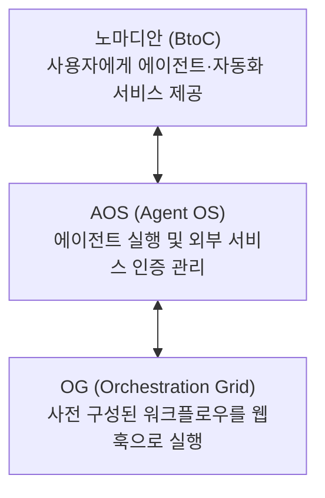
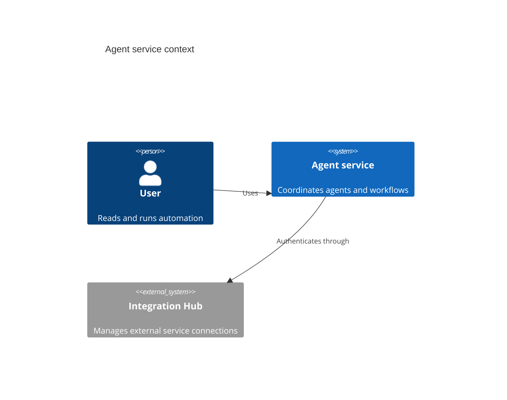

# Explore diagrams

Open either diagram in the diagram viewer. Try zoom, Fit, full screen, and search for **Agent**. Document search uses Command+F on macOS and Ctrl+F on Windows; the same shortcut searches labels when the diagram viewer is focused.

## Flowchart

## C4 context

